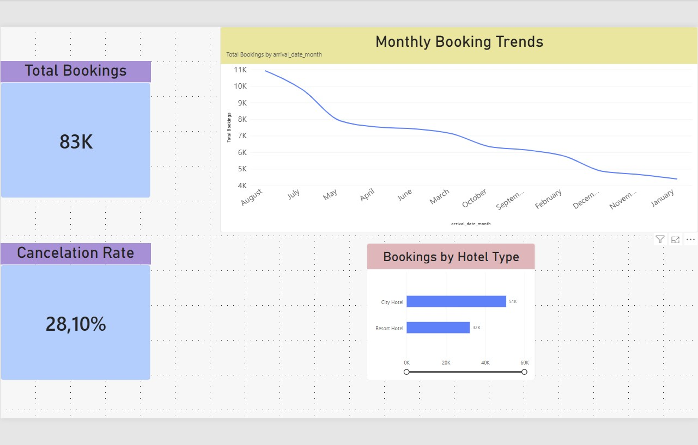

# 🏨 Hotel Booking Analytics: PostgreSQL & Power BI

An end-to-end data analytics project demonstrating data extraction, transformation, modeling, and visualization for hospitality industry decision-making.

---

## 📌 Project Overview
This project analyzes hotel booking data to evaluate booking demand, cancellation trends, and revenue characteristics across different hotel properties (City vs. Resort Hotels). The workflow transitions from raw data staging in **PostgreSQL** to data cleaning via SQL Views, culminating in an interactive executive dashboard created with **Power BI Desktop**.

---

## 🛠 Tech Stack
* **Database / Data Prep:** PostgreSQL (SQL Views, Data Type Conversions, Logic Rules)
* **Visualization & Analytics:** Power BI Desktop (DAX Measures, Data Modeling, KPI Reporting)
* **Environment:** Visual Studio Code / pgAdmin

---

## 📊 Key Insights & Metrics
* **Total Bookings & Demand Trends:** Evaluated booking distribution over operational months to identify peak seasonality.
* **Cancellation Analysis:** Built calculated DAX measures to track overall cancellation rates and quantify revenue loss.
* **Property Performance:** Compared key performance metrics between Resort and City hotel segments.

---

## 📐 Data Architecture & Workflow
1. **SQL Transformation (`public.v_cleaned_hotel_bookings`):**
   * Cleaned raw staging data, addressed null values, and standardized data types.
   * Constructed custom columns for calendar and aggregation logic.
2. **Power BI Modeling & DAX:**
   * Established dynamic measures including `Total Bookings` (`COUNTROWS`) and `Cancellation Rate` (`DIVIDE` / `CALCULATE`).
   * Configured executive KPI card visuals, monthly trends, and segmental comparisons.

## 💡 Business Problem & Value
* **Problem:** Hotel management lacked a centralized view to track booking volume trends and isolate key drivers of high cancellation rates across different hotel types.
* **Solution:** Developed an integrated data pipeline and executive dashboard that highlights operational seasonality, tracks revenue-at-risk from cancellations, and enables data-driven decision-making for overbooking and promotional strategies.

---

## 🔮 Future Improvements (Next Steps)
If given additional time and data resources, the next iterations of this project would include:
* **Advanced Analytics:** Building predictive models (e.g., Logistic Regression or XGBoost) to forecast cancellation probability per booking.
* **Data Integration:** Connecting directly to live APIs or pipeline tools (e.g., Apache Airflow / dbt) for automated data ingestion.
* **Deeper Segmentation:** Incorporating customer demographic and marketing channel data to calculate Customer Lifetime Value (CLV).
---

## 📂 Repository Structure
* `sql/` - Contains SQL scripts and View definitions used for data prep.
* `docs/` - Dashboard screenshots and documentation assets.

* ---

## 🖼️ Dashboard Preview

